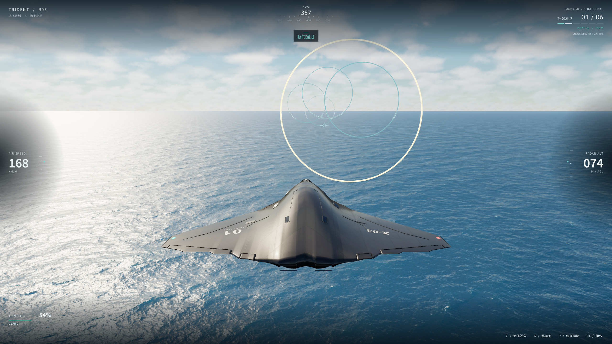
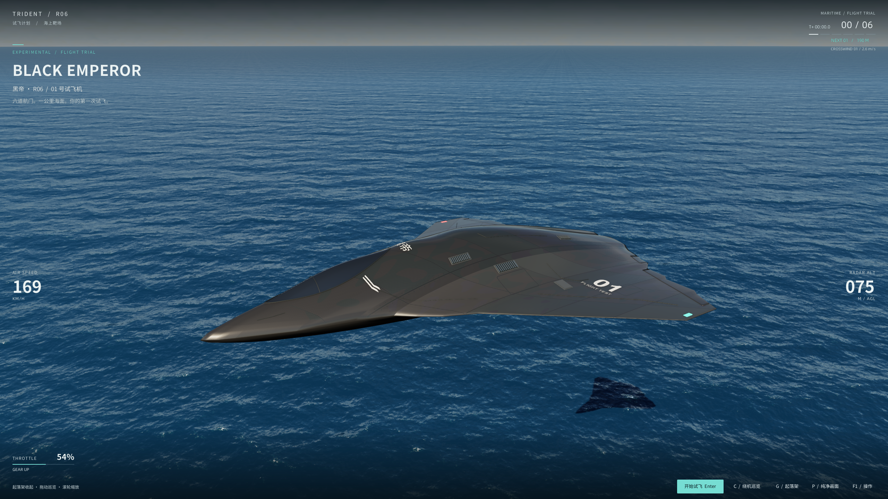
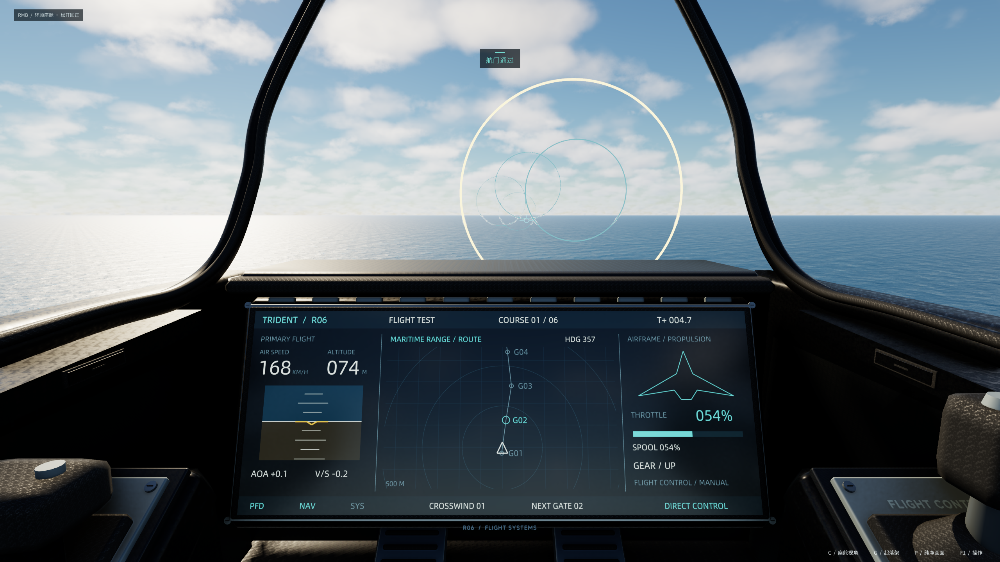
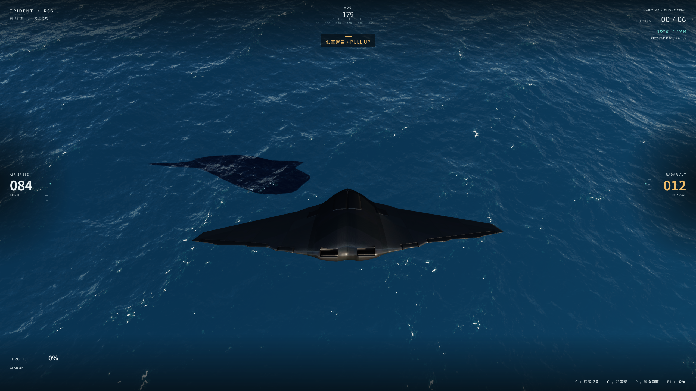
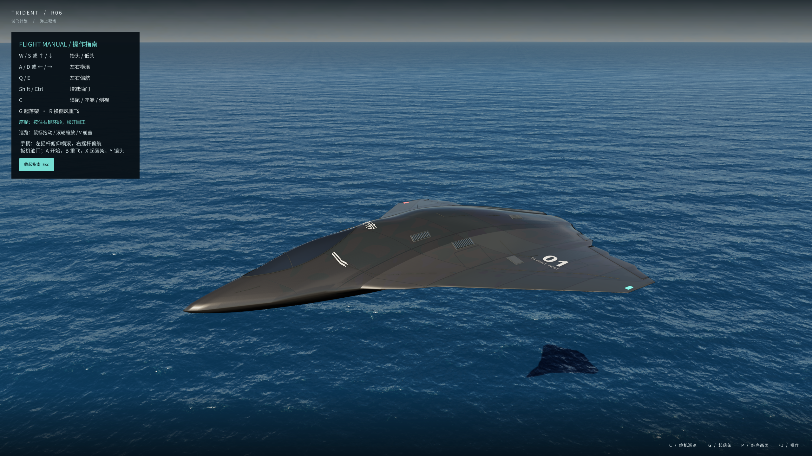
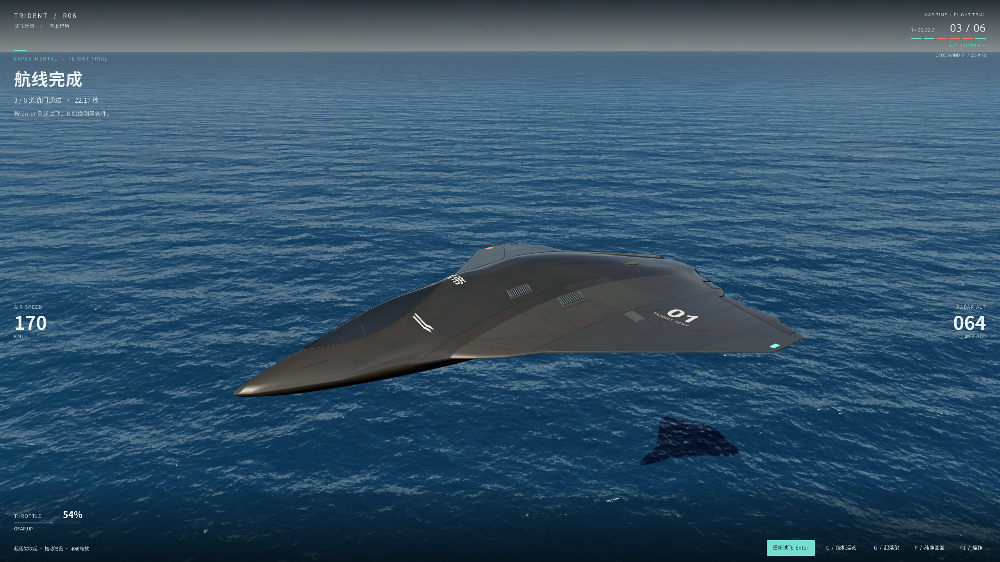
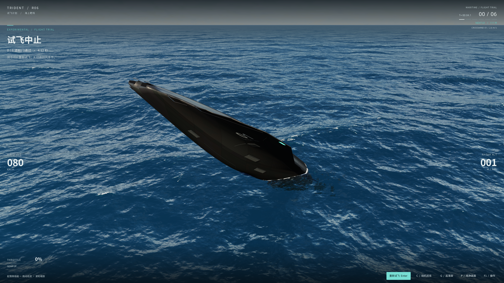

# TRIDENT / 黑帝 R06 海上试飞

UrhoX 原生 Lua 复刻，来源：所提供的 `trident-h5.zip`。保留原 R06 模型、六道航门、三组侧风与飞行操控；画面使用桌面延迟渲染重新制作。不是 WebView 包装。

Native Lua recreation of the supplied H5 trial, using the original R06 asset and flight model. Desktop rendering is rebuilt in UrhoX rather than embedded in a WebView.

## 2K 截图 / Screenshots

以下七张 PNG 均为 **2560×1440 原生引擎截图**，不是旧图放大；使用同一套最高画质设置，保留完整 HUD。原图保存在 [`screenshots/2k/`](screenshots/2k/)，点击图片可查看或下载。

Seven native 2560×1440 PNG captures, rendered at the project's full quality settings without upscaling. The cockpit uses its physical instruments rather than duplicate HUD panels.

**飞行 HUD / Flight**



| 待机 / Ready | 座舱 / Cockpit |
|---|---|
|  |  |
| **低空警告 / Low-altitude warning** | **操作指南 / Flight manual** |
|  |  |
| **航线完成 / Trial complete** | **试飞中止 / Trial aborted** |
|  |  |

## 本地启动 / Run locally

本次验证使用 UrhoX 的 Linux Release `UrhoXRuntime` 与 `UrhoXCLI`。需要图形桌面与支持 compute shader 的 OpenGL 驱动。引擎、运行时二进制和生成的开发工具不包含在本仓库中；本仓库不是可独立构建的完整引擎发行版，需要自行取得兼容的 UrhoX 开发环境。

两份中文字体使用 **Git LFS**。安装 Git LFS 后执行下面的拉取命令；截图是普通 PNG，不需要 LFS 才能查看。

新机器克隆后，先准备已构建的 UrhoX 引擎，再从本项目根目录同步开发工具；`--refresh` 保留项目的 `scripts/` 和 `assets/`。生成器要求 `AGENTS.md` 存在；它是被 Git 忽略的生成文件，因此首次克隆先补空标记，随后由生成器写入完整内容：

```bash
git lfs install --local
git lfs pull
export URHOX_ENGINE=/absolute/path/to/urhox
test -e AGENTS.md || touch AGENTS.md
python3 "$URHOX_ENGINE/tools/dev/create_local_project.py" . --refresh
cp "$URHOX_ENGINE/engine/bin/Data/LuaScripts/Hand-picked/EngineWaterDemo/assets/Shaders/"OceanWater.shader{,inc} assets/Shaders/
tools/run-local.sh run -x 2560 -y 1440
```

On a new checkout, fetch the two font files with Git LFS, build UrhoX separately and run its local-project generator with `--refresh` to restore the ignored development kit and launch scripts. Copy the two ocean shader files from your compatible engine into the project as shown above; these local dependencies are excluded from Git. The project source and assets remain intact. Screenshots are regular PNG files, not LFS pointers.

开发环境准备好后，从项目根目录启动：

```bash
tools/run-local.sh run -x 1600 -y 900
```

运行时无需登录或联网下载。`scripts/`、`assets/` 直接加载；编辑 Lua 后重启即可。引擎路径可通过 `URHOX_ENGINE` 覆盖。更多本地工具说明见生成后的 `LOCAL-DEV.md`。

海水使用兼容引擎自带的 `EngineWaterDemo` shader 与细节法线资源。上面的复制命令将两份 shader 放到其相对引用所需的位置，作为被 Git 忽略的本地依赖；本仓库不分发其实现副本。缺少该示例资源的引擎版本无法完整渲染海面。

## 操作 / Controls

| 操作 | 按键 |
|---|---|
| 开始 / 完成后重飞 | Enter |
| 换下一组侧风并重飞 | R |
| 抬头 / 低头 | W / S，或 ↑ / ↓ |
| 左右横滚 | A / D，或 ← / → |
| 左右偏航 | Q / E |
| 增减油门 | Shift / Ctrl |
| 追尾 / 第一人称 / 侧视 | 飞行中 C |
| 座舱内环顾 / 回正 | 按住鼠标右键移动 / 松开；不改变飞机方向 |
| 自动绕机 / 手动巡览 | 非飞行时 C / 鼠标拖动，滚轮缩放 |
| 起落架 | G |
| 装饰舱盖 | 非飞行时 V |
| 隐藏 / 恢复 HUD | P；Esc 恢复 |
| 操作指南 | F1 或界面按钮；Esc 关闭 |

标准 SDL 手柄映射：左摇杆俯仰和横滚，右摇杆横轴偏航，左右扳机减/加油门；A 开始、B 重飞、X 起落架、Y 镜头、方向键上开合舱盖。尚未使用实体手柄验证。

## 画面 / Rendering

- 原始 GLB 的 88 个节点、73 个网格及动画转轴；起落架舱门先开、支柱随后展开。
- 最高材质质量、16× 各向异性过滤、4096 阴影与 16 次 PCF。
- 原生 FFT 波浪、细波法线与白沫、深海吸收/散射、屏幕空间水面反射。
- 物理大气、体积云、256 分辨率天空光照捕获；PBR 石墨涂层和座舱清漆。
- 沿后掠机翼排列的蒙皮接缝、检修口、齐平紧固件与涂层微法线；细节按屏幕覆盖率衰减，不依赖原模型缺失的 UV。
- 机身新增六组实体百叶格栅、两块检修盖、压边与紧固件，沿原模型表面法线布置，保留原外形和活动关节。
- 包围式座舱：连续舱壁与脚舱、内倾左右控制台、座椅、脚蹬、舱盖密封/锁扣、金属压边与碳纤维面板。左油门杆、右侧杆随实际输入运动。
- 单块倾斜全景主屏显示实时姿态、空速、高度、航门航线、油门和发动机响应；航图采用航向朝上。2304×900 动态纹理在座舱可见时最高 30 Hz 刷新。
- 座舱固定在机体上，相机可独立环顾（左右各 75°）并平滑回正；隐藏 HUD 不隐藏实体仪表。控制台边键、脚蹬和弹射拉环目前仅为装饰，没有点击操作或弹射功能。
- 外视角采用航空仪表式 HUD：两侧空速/高度与动态刻度、顶部航向带、下一航门距离、细油门条和透明指令栏。座舱模式隐藏重复仪表，低空警告仍保留。
- SSR、SSGI、GTAO、TAA、ACES 与克制的 Bloom。运动模糊关闭以保证航门和仪表清晰。

The cockpit is a complete aircraft-fixed tub with angled side consoles, animated HOTAS controls and one panoramic live display. Hold the right mouse button to look around; release to recenter. Physical exterior grilles, access covers and fasteners supplement the original meshes. Geometry is batched by material, and the display updates at up to 30 Hz while visible. Other cockpit switches and pedals are decorative. This remains a desktop prototype, not production AAA asset quality. Screenshots use Mesa llvmpipe and do not establish dedicated-GPU frame rates. Mobile and Web builds have not been verified.

当前是高画质桌面原型，不等于已经完成 3A 资产制作。保留原外形与标记，新增的座舱是为本复刻设计的表现层，不是原机真实结构的工程还原。还没有高分辨率手工贴图、损毁系统或音频。这里的截图由 Mesa llvmpipe 实际渲染，不能作为独显性能结论；移动端和 Web 未验证。

布局参考 / Layout references: [Saab Gripen E 19×8-inch Wide Area Display](https://www.saab.com/newsroom/press-releases/2018/saab-presents-gripen-e-simulator-with-wide-area-display)、[F-35 cockpit](https://www.jsf.mil/cockpit)。借鉴宽屏信息整合和左右控制台包围飞行员的空间关系，没有使用参考照片作为游戏贴图，也不宣称复刻其真实航电系统。

## 验证 / Verification

```bash
tools/run-local.sh lua Tests/Flight.lua
tools/run-local.sh validate
python3 tools/test_interactive.py
```

飞行测试使用独立从原版 Cannon 实测的轨迹：三组侧风的无输入通关时间和命中数一致，位置容差 3 cm；还覆盖非对称操控、油门边界、航门半径两侧、重置与撞水。交互测试通过引擎输入协议实际点击开始、按键切换起落架/镜头/HUD、加油门、换侧风、通关与坠海。

**物理差异：**空中使用原版质量、箱形惯量、气动力、阻尼和 60 Hz 积分；撞水按原版机心高度 1.6 m 截止，但没有复刻 Cannon 接触海面时短暂的碰撞反弹。因此测试俯冲的结束时间约为 4.117 s，原版约为 4.200 s，不宣称全程逐位一致。

在无桌面的 Linux 上使用 Xvfb 截真实 OpenGL 画面：

```bash
mkdir -p .tmp
xvfb-run -a -s '-screen 0 1280x720x24' tools/run-local.sh run \
  -x 1280 -y 720 -screenshot="$PWD/.tmp/ready.png" -screenshot-frame=120

ENTRY=Tests/Capture.lua xvfb-run -a -s '-screen 0 1280x720x24' tools/run-local.sh run \
  -view=flight -x 1280 -y 720 -screenshot="$PWD/.tmp/flight.png" -screenshot-frame=120
```

重新截取全部七个 2K 状态（保持最高画质，每个状态独立启动并等待天空光照收敛）：

```bash
mkdir -p screenshots/2k
for view in flight ready cockpit warning manual finish crash; do
  ENTRY=Tests/Capture.lua xvfb-run -a -s '-screen 0 2560x1440x24' \
    tools/run-local.sh run -view="$view" -x 2560 -y 1440 \
    -screenshot="$PWD/screenshots/2k/$view.png" -screenshot-frame=100 || break
done
```

截图场景可选 `ready`、`flight`、`warning`、`gear`、`photo`、`finish`、`crash`、`manual`、`cockpit`、`cockpit-left`、`cockpit-right`、`cockpit-bank`、`detail`、`side`。`ready` 检查初始菜单，`warning` 通过真实俯冲在撞水前检查低空提示。左右座舱图检查侧控制台和舱壁；`cockpit-bank` 使用真实抬头/横滚/加油门输入，并放下起落架、隐藏 HUD，检查不同姿态与仪表数值；`detail` 是机身近景。测试入口先执行真实飞行积分到指定状态，再冻结该测试实例以便观察；海浪和云继续渲染。软件渲染较慢，请等待。

## 资源与维护 / Source assets

`source/` 只保存从原始 ZIP 解出的 GLB 和 HDR。原版浏览器 JavaScript 不随本项目分发；复刻版使用 Lua，运行只依赖 `scripts/`、`assets/` 与兼容的 UrhoX 环境。

需要重新导入原模型时：

```bash
python3 tools/import_aircraft.py /path/to/trident-h5.zip \
  --cli "$URHOX_ENGINE/build_desktop_gl/bin/UrhoXCLI"
```

导入器分别导入刚性网格，再保留源层级与关节姿态，避免通用导入器扁平化节点后丢失起落架转轴。

## 素材来源与许可 / Asset credits and licensing

- **R06 模型**：来自所提供的 H5 工程，版权归原权利人所有。原始包未附模型的开源许可证；本仓库不另行授予 `source/R06.glb` 及其派生模型的使用或再分发许可。
- **HDR 环境图**：`source/kloppenheim_06_puresky_2k.hdr` 来自 [Poly Haven — Kloppenheim 06 Pure Sky](https://polyhaven.com/a/kloppenheim_06_puresky)，按 [CC0](https://polyhaven.com/license) 提供。本地文件的 MD5 与官方 2K HDR 下载记录一致：`590a829b3cf71216451655e601d542c6`。原生场景使用程序化大气，这张 HDR 仅用于保留原版参考。
- **Noto Sans SC**：Adobe，SIL Open Font License 1.1；完整版权与许可见 [`assets/Fonts/OFL.txt`](assets/Fonts/OFL.txt)。字体许可证不适用于整个项目。
- **UrhoX**：外部引擎依赖，不随本仓库分发。本仓库不授予引擎及其资源的许可。

本仓库目前没有项目级开源许可证。公开访问不代表为全部代码、模型或截图授予了统一的开源许可；任何后续许可证均须明确适用范围并保留第三方权利。
